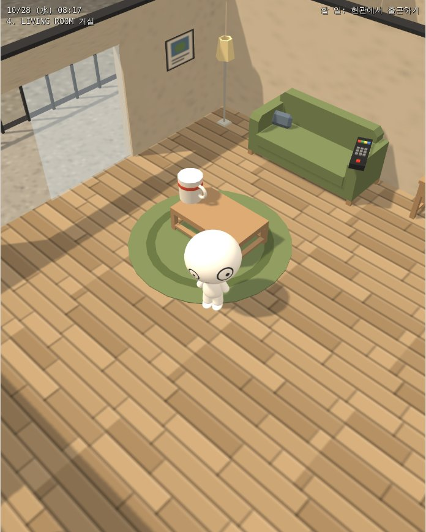
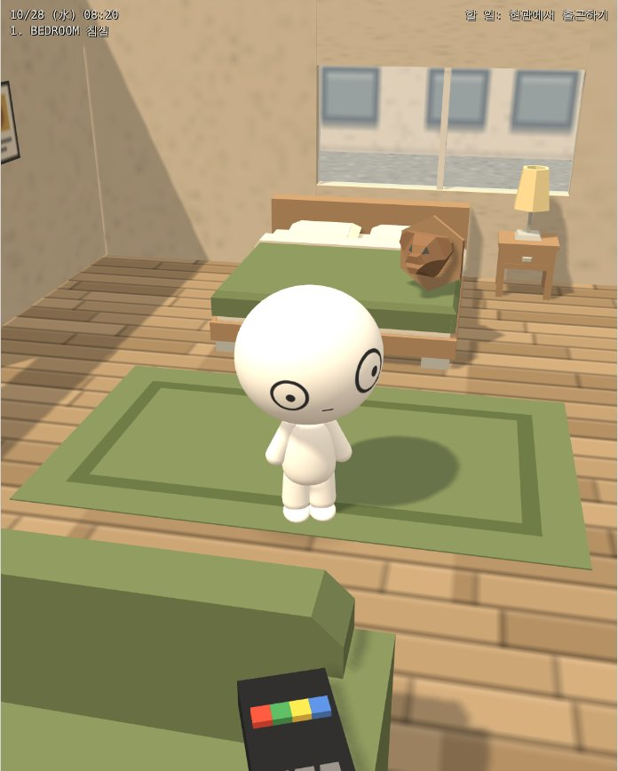
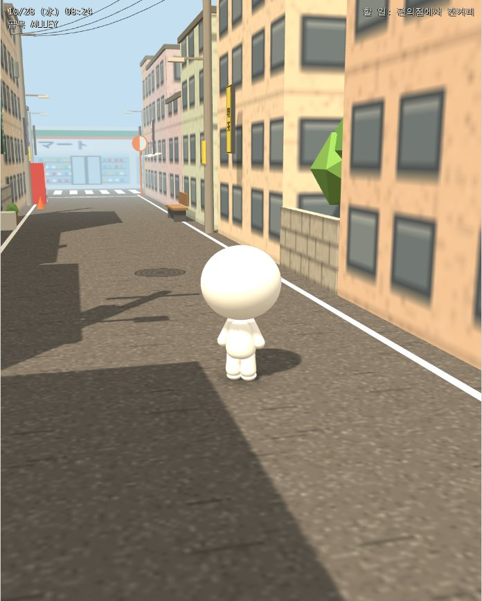
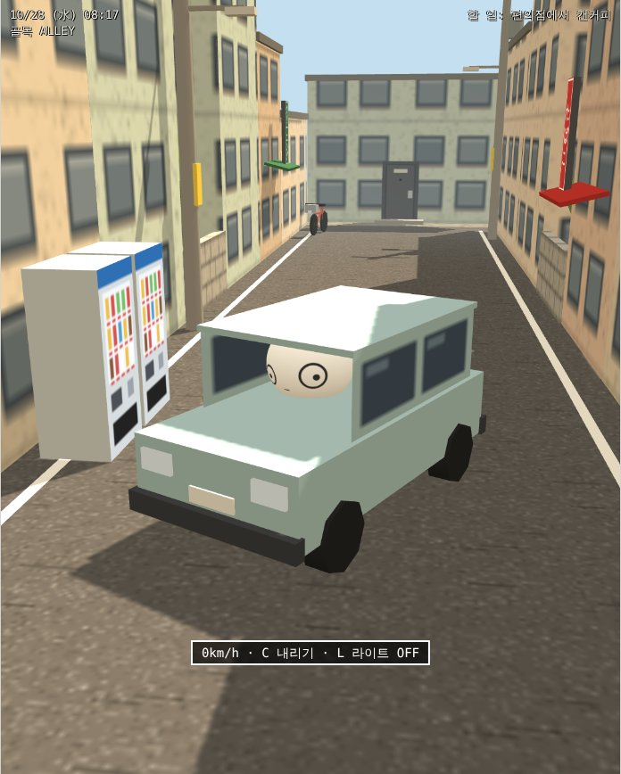
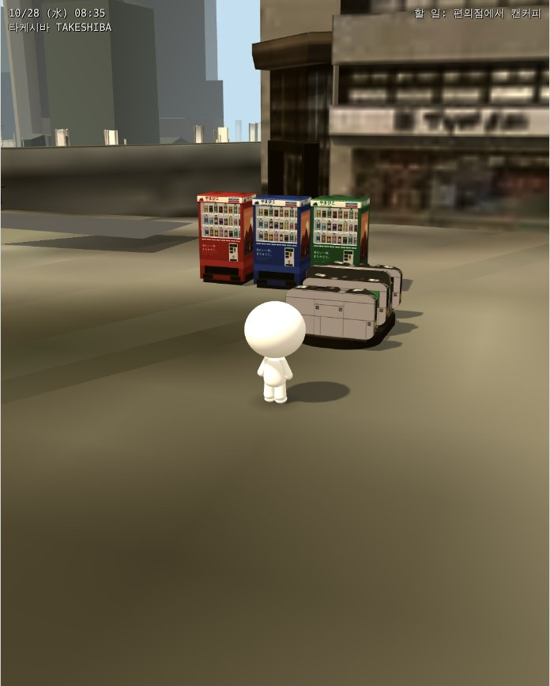
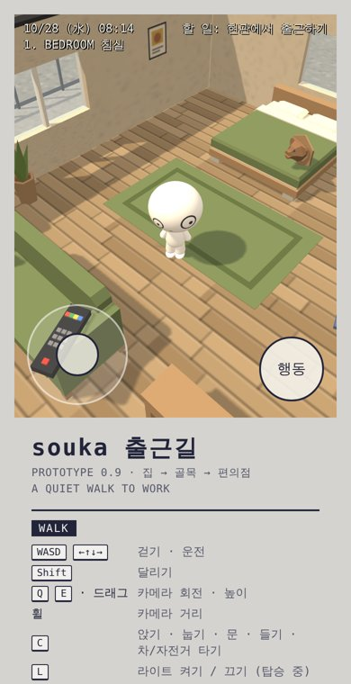
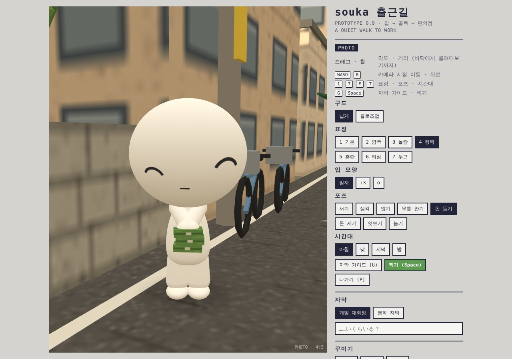

# souka 출근길

souka 마스코트를 직접 조종해 집 안을 돌아다니고, 현관을 나서 골목과 편의점까지 걸어가며
인스타그램용 사진(4:5)과 릴스(9:16)를 찍는 레트로 3D 웹 게임입니다.
골목 끝 개찰구를 지나면 도쿄 타케시바(PLATEAU 3D 도시 모델)로, 패널 버튼으로는 요코하마 요시노초 동네(오오카강·공원·阪東橋公園)로 갈 수 있습니다.
2000년대 일본 저예산 3D 게임 느낌을 목표로 합니다.

## 스크린샷

| 집 (거실) | 집 (침실) | 골목 |
| :---: | :---: | :---: |
|  |  |  |
| **운전** | **타케시바 (PLATEAU)** | **모바일** |
|  |  |  |

**사진 모드** — 표정·포즈·시간대·자막을 고르고 4:5로 찍기



## 기술 스택

| 구분 | 사용 기술 |
| --- | --- |
| 언어 · 프레임워크 | TypeScript, React 19 |
| 3D 렌더링 | Three.js (WebGL) |
| 빌드 · 배포 | Vite 7, vite-plugin-singlefile, Vercel |
| 브라우저 API | Canvas 2D, MediaRecorder · captureStream, Pointer Events, localStorage |
| 3D 에셋 처리 | glTF/GLB, FBX2glTF, gltf-transform, meshoptimizer, sharp |
| 테스트 | Playwright (헤드리스 렌더링 스크린샷) |

### 주요 구현

- **React ↔ Three.js 상태 연결**: 게임 루프는 Three.js가, 패널·HUD는 React가 맡고 `useSyncExternalStore`로 상태를 공유
- **충돌 처리**: 가구·건물은 AABB, 600m 도시 지도는 삼각형 공간 격자로 지형 높이·벽·카메라 충돌 판정 (쿼리당 약 0.03ms)
- **3D 에셋 최적화**: 수백만 정점 FBX 모델을 메시 단순화·텍스처 압축으로 수만 정점, 수 MB 이하로 축소
- **사진·영상 캡처**: 4:5 사진 저장과 9:16 릴스 합성·녹화 (Canvas + MediaRecorder)
- **모바일 대응**: 가상 조이스틱, 상황별 액션 버튼, 핀치 줌
- **단일 HTML 빌드**: 모든 에셋을 한 파일에 담고, 용량 제한(16MB)에 맞춰 무거운 모델만 빌드별로 분리

## 실행

요구 사항: Node.js 20 이상, npm

```bash
npm install
npm run dev          # http://localhost:5173
```

| 명령 | 설명 |
| --- | --- |
| `npm run dev` | 개발 서버 |
| `npm run build` | 타입 체크 + 프로덕션 빌드 → `dist/` |
| `npm run build:single` | 모든 코드를 `dist/index.html` 한 파일에 담은 빌드 (claude.ai 아티팩트 게시용) |
| `npm run preview` | 빌드 결과 미리보기 |
| `npm run typecheck` | 타입 체크만 |

## 조작

| 키 | 동작 |
| --- | --- |
| WASD / 방향키 | 걷기, 운전 |
| Shift | 달리기 |
| 드래그 · Q/E · 휠 | 카메라 회전 · 높이 · 거리 |
| C | 앉기, 눕기, 문, 물건 들기/놓기, 차·자전거 타기/내리기 |
| Z / X | 들고 있는 물건을 놓을 거리 |
| L | 차·자전거 라이트 |
| P | 사진 모드 (표정 1–7, 포즈 F(서기·생각·앉기·무릎 안기·돈 들기·돈 세기·엿보기·눕기), 시간대 T, 자막 가이드 G, 찍기 Space) |
| R | 릴스 모드 (V로 녹화 시작/정지) |
| B | 편집·창고 모드 (클릭·드래그로 물건·souka 옮기기, Q/E 회전, [ ] 크기, Delete 창고에 넣기) |

### 창고

편집 모드(B) 패널 아래의 창고에서 가구·소품·건물·자동차 188종을 방별 탭(거실, 침실, 주방, 욕실, 작업실, 소품, 바깥, 건물, 자동차)으로 골라 꺼낼 수 있습니다.

- 꺼낸 물건은 화면 가운데에 놓입니다. 큰 가구는 바닥에, 작은 물건(모니터, 램프, 책 등)은 그 아래 가구 위에 올라갑니다.
- 의자·소파·침대·변기·욕조·열린 상자 같은 물건은 꺼내자마자 C키로 앉거나 누울 수 있습니다.
- '창고에 넣기'를 누르면 꺼낸 물건은 사라지고, 원래 집에 있던 가구는 '보관함' 탭으로 가서 다시 꺼낼 수 있습니다.
- 자동차 탭의 차는 골목이나 타케시바에 꺼내 두면 C키로 타고 운전할 수 있습니다(라이트 L). 집 안에 꺼내면 장식입니다.
- 배치(꺼낸 물건 포함)는 브라우저의 localStorage(`souka-layout-v2`)에 저장됩니다.

## 구조

게임 본체는 Three.js 모듈이고, 옆 패널과 화면 위 글자(HUD, 자막, 토스트, 모달)는 React입니다.
두 쪽은 `Game` 객체 하나를 공유합니다. 게임 상태는 `G.S`, 화면에만 필요한 값은 `G.ui`에 있고,
게임이 `G.notify()`를 부르면 React가 다시 그립니다.

```
src/
  main.tsx, App.tsx       React 진입점 (게임을 stage에 붙임)
  styles.css
  ui/
    useGame.ts            게임 store 구독 훅
    Panel.tsx             조작 패널 (모드별 섹션, 표정·포즈·자막·꾸미기·화질·앨범)
    Overlays.tsx          HUD, 안내 문구, 토스트, 자막 미리보기, REC 표시
    Modals.tsx            찍은 사진 / 녹화한 릴스
    Warehouse.tsx         편집 모드의 창고 (분류 탭, 썸네일, 보관함)
  assets/kenney/          Kenney CC0 모델 (furniture, suburban, roads, commercial)
  assets/pack2/           두 번째 팩을 GLB로 변환한 것 (furniture, town, euro)
  assets/pack3/           일본 거리 소품·차 (big/ 아래는 단일 파일 빌드에서 빠지는 큰 모델)
  game/
    index.ts              createGame(): 모듈을 순서대로 조립
    core.ts               렌더러, 씬, 시드 랜덤, 텍스처 도우미, 충돌, 편집 가능한 물체 등록 (O/E)
    types.ts              State, UiState, EditObj 등 타입
    lighting.ts           시간대별 하늘·조명
    world/alley.ts        골목 (건물, 정원, 간판, 전봇대, 가로등, 자판기, 편의점)
    world/house.ts        집 구조 (방 6개 + 베란다, 벽·바닥, 손으로 만든 소품과 큰 머그컵·리모컨)
    world/yokohama.ts     요코하마 요시노초~반도바시: 국도 21호, 오오카강과 다리, 선형 공원, 반도바시 공원과 고가도로, 집(STUDIO Z)
    world/city.ts         타케시바 지도 (처음 갈 때 로딩, 삼각형 격자로 땅 높이·벽 판정, 개찰구 이동)
    heavyAssets.ts        큰 모델 목록 (단일 파일 빌드는 heavyAssets.empty.ts로 바꿔치기)
    character.ts          souka 모델, 표정, 입 모양, 꾸미기, 포즈
    interact.ts           C키 상호작용, 물건 들기/놓기, 집↔골목 이동
    vehicles.ts           자동차·자전거
    catalog.ts            창고 목록 (Kenney 모델별 한글 이름, 분류, 크기, 앉기 여부)
    props.ts              Kenney 모델 로딩, souka 톤 보정, 집 기본 가구 배치, 썸네일, 창고 동작
    modes.ts              사진·릴스 모드, 구도 프리셋
    capture.ts            사진 저장, 릴스 합성·녹화, 자막 그리기, 화면 크기 맞춤
    edit.ts               편집 모드와 배치 저장
    quality.ts            화질 프리셋 (해상도, 텍스처 필터, 그림자)
    input.ts              키보드·마우스
    loop.ts               매 프레임 갱신 (이동, HUD, 카메라, 벽·건물 가리기)
```

### 에셋과 톤

집 가구와 창고 물건은 [Kenney](https://kenney.nl)의 Furniture Kit, City Kit Suburban / Roads / Commercial에서
가져왔습니다(CC0, `src/assets/kenney/LICENSE-*.txt`). 원래 색은 장난감처럼 쨍해서 `props.ts`의 `PALETTE`로
재질 이름별 색을 하우스 시트 팔레트(베이지, 나무색, 회색, 올리브 소파, 청회색)에 맞추고,
텍스처를 쓰는 도시 키트는 셰이더에서 채도를 낮춥니다. 새 Kenney 팩을 추가할 때도 이 규칙을 따르면 톤이 맞습니다.

`assets/pack2`는 같은 출처의 FBX 팩 3개(나무 가구 23종, 텍스처 주택·상점 9종, 유럽풍 건물 8종)를 GLB로 바꾼 것입니다.
변환하면서 cm를 m로 바꾸고, 가구는 정면이 +z를 보도록 90° 돌렸고, 가구 재질 이름은 `PALETTE` 키(wood, woodDark, fabric 등)로,
건물 재질은 `eu*` 키로 바꿨습니다. 여러 재질이 섞인 메시는 재질별로 나눈 뒤 내보냈고(three.js GLTFExporter가 섞인 메시의 재질을
엇갈리게 내보내는 문제 때문), gltf-transform으로 weld · dedup · quantize 했습니다. 은행 모델은 텍스처가 없어 뺐고,
가장 큰 유럽풍 빌딩(Building1_Large)은 너무 무거워 같은 모양의 작은 버전만 넣었습니다.

`assets/pack3`는 사용자가 따로 받은 일본 거리 에셋입니다(자판기 3색, 개찰구, 노점, 역 앞 빌딩, 일본 주택,
혼다 프렐류드, 스카이라인 R32, GT-R, 수프라, 타케시바 PLATEAU 지도). FBX는 FBX2glTF로 GLB로 바꾸고, 수백만 정점짜리
모델은 gltf-transform + meshoptimizer로 노드 변환을 정점에 굽고(flatten, clearNodeTransform) 법선·UV를 뺀 뒤
weld · simplify 해서 수만 정점으로 줄였습니다. 법선이 없는 모델은 게임에서 `flatShade()`로 각진 법선을 다시 만들어
로우폴리 느낌을 냅니다. 텍스처는 256~512px JPEG/WebP로 줄였습니다.
**이 에셋들은 원래 배포처의 라이선스를 따릅니다(재배포 금지일 수 있음).** 저장소를 공개로 둘 때는 확인이 필요합니다.

타케시바 지도는 건물이 큰 메시 하나로 묶여 있어 상자 충돌을 쓸 수 없습니다. 그래서 `city.ts`가 처음 로딩할 때
삼각형을 6m 격자에 넣어 두고, 걷기·운전은 "발밑 땅 높이"(계단·턱은 0.55m까지)와 "앞에 벽이 있는지"를,
카메라는 "souka와 카메라 사이에 벽이 있는지"를 이 격자로 물어봅니다(한 번에 0.03ms 정도).

### 알아 둘 점

- 골목과 집은 시드 랜덤(`rnd()`)으로 텍스처와 배치를 만듭니다. `index.ts`의 모듈 순서나
  모듈 안의 `rnd()` 호출 순서가 바뀌면 거리 모습이 달라집니다.
- three.js는 원본 프로토타입과 똑같은 화면을 위해 `0.128.0`에 고정했습니다. 올릴 때는 조명 단위와
  색 관리 기본값이 바뀌므로 화면을 비교하며 맞춰야 합니다.
- `world/alley.ts`, `world/house.ts`, `vehicles.ts`는 원본 프로토타입 코드를 거의 그대로 옮겨서
  타입이 느슨합니다(`strict: false`). 새로 만드는 코드부터 타입을 붙여 가면 됩니다.
